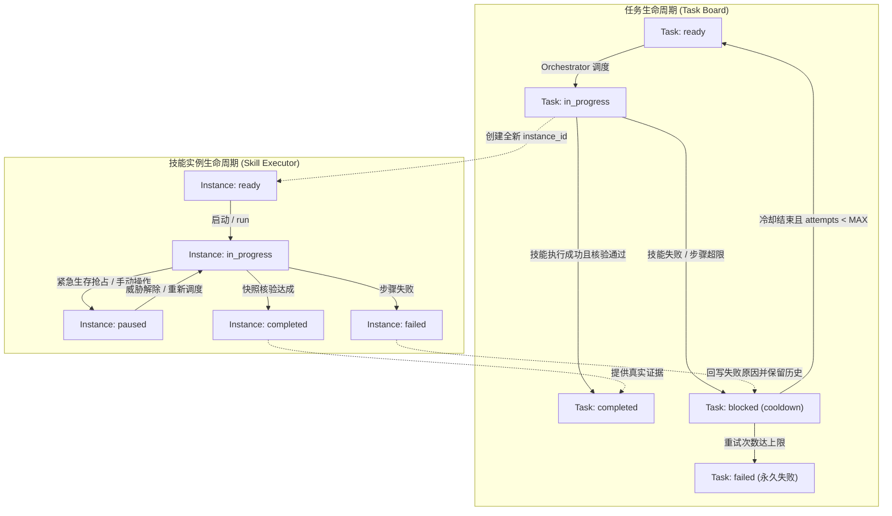

# 架构（当前有效）

> 本文只描述**现在真正在跑**的系统。历史架构（A 栈的 TypeScript bridge / mcp-server / agent、
> HTTP 18788 那一套）已全部归档，见 [`archive/README.md`](archive/README.md)。
>
> 对应代码：`DontStarveWhaleSurvivor/`（Lua 模组，0.41.1）+ `lib/`（DSH 插件，0.12.0）

---

## 1. 一句话

**游戏里的 Lua 模组负责"看"和"做"，插件进程里的 Node 负责"想"和"管"，中间用本机 JSON 文件桥连接。**

DSH 不能直接把鼠标点进游戏，饥荒的 Lua 模组也不能监听端口。所以整条链路被拆成三个互不信任的角色，
用"谁写哪个文件"来划分权限。

---

## 2. 核心架构图

```
┌──────────────────────────── 调用方（任选其一，共用同一条链路）────────────────────────────┐
│  ① DSH 会话：模型 → MCP 工具（Streamable HTTP + SSE）                                      │
│  ② 游戏里按 F8：插件内置 AI → 同一套工具定义                                               │
└───────────────────────────────────────┬─────────────────────────────────────────────────┘
                                        │  工具 = lib/tools.js 的 TOOLS（43 个 = 5 本地 + 38 动作）
                                        ▼
┌──────────────────────────── DSH 插件进程（Node，lib/）────────────────────────────────────┐
│                                                                                          │
│  tools.js  executeTool()                                                                 │
│     ├─ 本地工具 → 调度/读快照/写笔记/复合技能（advance_task / get_state / get_guide / update_notes / run_skill） │
│     └─ 动作      → dispatcher.dispatch()  ────────────────┐                               │
│                                                            │                               │
│  dispatcher.js  ①参数与快照校验 ②拿控制租约 ③写命令 ④等结果 ⑤核对真实状态  ◄── 唯一允许    │
│                 （白名单：ACTION_SPECS 的全部 38 个动作）                      下发动作的地方 │
│                                                                                          │
│  planner/       决策系统：planner-core (决策树) / task-board (任务调度) /                  │
│                 decision-arbiter (统一决策出口) / world-memory (按世界持久化)             │
│  skills/        复合技能：gather-resources / establish-home / survival-stabilize 等         │
│  actions/       动作规格与快照查询：按领域拆分的动作规格 / 背包与装备的统一读取             │
│  control.js     Control Lease（本机文件锁 + 跨进程互斥 + 换手 ACK）                        │
│  bridge.js      文件桥客户端：找目录、读状态、写命令、读结果、权威性判定                     │
│  state/snapshot.js  把 whale_state.json 归一化成同一份快照（文本渲染 / 字段校正）           │
│  mcp-server.js  MCP 服务器（HTTP，默认 18090）        agent.js  F8 内置 AI 循环             │
│  index.js       插件入口：配置、预设、入口工具、自动装模组                                   │
└───────────────────────────────────────┬─────────────────────────────────────────────────┘
                                        │  本机文件桥（游戏存档目录 / 模组目录）
                    ┌───────────────────┴───────────────────┐
                    │  whale_state.json  ← 模组写，Node 读  │   状态（1 秒一版）
                    │  whale_cmd.json    ← Node 写，模组读  │   指令（8 秒有效期）
                    │  whale_result.json ← 模组写，Node 读  │   结果（单槽）
                    │  *.lease/*.ack     ← 双方写            │   控制租约与换手回执
                    └───────────────────┬───────────────────┘
                                        ▼
┌──────────────────────────── 游戏进程（Lua 模组，DontStarveWhaleSurvivor/）────────────────┐
│                                                                                          │
│  observe.lua    把世界翻成文字（时间/位置/三维/背包/附近/威胁）→ 写 state                  │
│  nearby.lua     结构化附近：9 个桶、带 #N 引用、带 snapshot_id、带 delta、带稳定句柄 h…             │
│  targetrules.lua ★ TARGET-REFRESH：固定 target_kind 枚举 + 实时找最近目标 + 稳定句柄注册表          │
│  actor.lua      Actor Provider：只认"本地主机、活着、非灵魂"的那个玩家                     │
│  bridge.lua     读命令、写结果、维护租约回执（含 job_cleared）                             │
│  guard.lua      ★ 第二道闸：白名单 + 参数 + 目标 + 租约 + 代际 + 权限，逐条复核             │
│  native.lua     ★ 原版能力薄封装：真实照明 / 原版 RunAway 几何 / 玩家 ATTACK 动作            │
│  actions.lua    动作实现：BufferedAction + locomotor:PushAction（和玩家点鼠标同一条路）     │
│  chores.lua     ★ 内部保命与家务（不直接暴露给模型，Node 侧通过 dispatcher 下发原子动作）      │
│  macros.lua     宏（仍在，但**不对模型开放**）                                             │
│  reflex.lua     保命反射：血少/天黑/火灭/贴脸时自己动手；解决不了就上报紧急需求               │
│  hud.lua        游戏内 HUD；config.lua 配置（夹到安全区间）                                │
└──────────────────────────────────────────────────────────────────────────────────────────┘
```

**为什么要有两道闸**：Node 侧的白名单防"模型乱点"，Lua 侧的 guard 防"Node 被绕过/被改坏"。
两边都必须校验目标仍然合法——因为从 Node 判断到游戏执行之间，世界可能已经变了。

---

## 3. 三个角色与职责边界

| 角色 | 能做什么 | 不能做什么 |
|---|---|---|
| **Lua 模组** | 读世界、写状态、执行 `BufferedAction`、写结果、维护租约回执 | 不能监听端口、不能调用网络、不能自己决定动作 |
| **插件进程（Node）** | 解析状态、暴露工具、校验与授权、写命令、核对结果 | 不能直接改游戏内存、不能跳过 guard（它根本改不了 Lua） |
| **调用方（模型/F8）** | 调工具、读回执 | 不能直接写命令文件、不能指定任意 prefab、不能绕过 `snapshot_id` |

---

## 4. 文件桥

### 4.1 文件与方向

| 文件 | 谁写 | 谁读 | 作用 | 时效 |
|---|---|---|---|---|
| `whale_state.json` | 模组 | Node | 世界状态（文本 + JSON） | 每 1 秒重写；> 5 秒算过期 |
| `whale_cmd.json` | Node | 模组 | 一条动作指令 | **8 秒**（过期不执行） |
| `whale_result.json` | 模组 | Node | 结果回执 | 单槽，可能被 reflex 覆盖 |
| `whale_settings.json` | Node | 模组 | 攻略/额外要求等 | 随改随推 |
| `whale_pause.json` | Node | 模组 | 「思考时暂停」开关 | — |
| 租约/回执 | 双方 | 双方 | Channel 1（持久化，Klei 头）写租约；ACK 由模组写 | TTL 30 秒 |

**两条通道**：`persist`（走 `TheSim:GetPersistentString` / `SetPersistentString`，带 Klei 头，跨重启保留）
和 `io`（普通 JSON 文件，走 bin64）。Lua 沙箱里 `GLOBAL.io == nil`，所以权威性判断走 persist 的
`Whale.authority_cache`（5 秒新鲜度）。

### 4.2 为什么用文件而不是 socket

饥荒的 Lua 沙箱不提供监听能力。文件桥是唯一在"模组不能开端口"前提下的可行方案，
代价是**延迟**（状态最多 1 秒旧）和**单槽覆盖**（见 `STATUS.md` 已知问题）。

---

## 5. 状态读取（模组 → Node）

1. `observe.lua` 每 `state_interval`（默认 1 秒）把世界翻成文字 + JSON，写 `whale_state.json`。
2. `nearby.lua` 按 `observe_interval`（默认 2 秒）重算附近，结果缓存 `scan_seconds`（默认 4 秒）。
3. Node 侧 `lib/bridge.js` 找到状态文件（多路径探测 + 按 mtime 选最新的活跃分片）。
4. `lib/state/snapshot.js` 把 JSON 归一化：统一字段名、补默认值、算 `ageMs`、
   渲染成给人看的中文文本。**F8、MCP、HUD、测试都走这一个函数**，所以三方看到的是同一份快照。

---

## 6. Nearby（模型看到的"附近"）

- **9 个桶**，顺序固定：`threats`（威胁）→ `pickupables`（可拾取物）→ `harvestables`（可收获）→
  `food`（食物）→ `resources`（资源）→ `containers`（容器）→ `structures`（建筑）→
  `creatures`（生物）→ `other`（其他）。
- **上限**：总数 60、每桶 12。超出按距离取近的，并在文本里标 `×N`（stack）与"已成熟/未成熟"。
- **引用**：每个条目有 `#N`，**只在当前 `snapshot_id` 内有效**。
  `snapshot_id = <runtime_id>-n<扫描序号>`：`runtime_id` 区分进程/世界，`n` 区分第几次扫描。
  世界重载后 `runtime_id` 变，旧引用自动作废。
- **稳定句柄（TARGET-REFRESH）**：能操作的目标还会带一个 `handle`（形如 `h1a`）。
  它**不含 GUID**，键是 `prefab + 格子坐标`，所以同一个目标在多次扫描之间句柄不变；
  这一帧没扫到（= 目标没了/被捡走）就立刻作废，并记下"为什么失效"（`target_gone` / `target_taken` /
  `in_limbo`），让回执能说实话而不是含糊的 `unknown_handle`。`#N` 仍然只是**当前观察里的展示编号**。
- **Delta**：与上一次**完整扫描集合**（不是上一帧截断后的列表）对比，算出新增/消失/变化，
  避免"因为超出上限被截掉"被误报成"消失了"。
- 只有 `pickupables` / `harvestables` 里的条目能被对应动作使用；
  白名单本身在 `pickuprules.lua` / `harvestrules.lua`，**观察侧和执行侧共用同一份**。

---

## 7. 工具表面（43 个）与共用链路

```
TOOLS = [advance_task, get_state, get_guide, update_notes, run_skill]   ← 本地：调度 / 读快照 / 写笔记 / 复合技能
      + ACTION_SPECS 的 38 个动作                                       ← 必须过 dispatcher
```

动作按领域放在 `lib/actions/specs/`：

| 文件 | 动作 | 数量 |
|---|---|---|
| `movement.js` | move_to / stop / seek | 3 |
| gathering.js | pickup_nearest / pickup_food / harvest_nearest / chop_nearest / mine_nearest / pickup / harvest / gather / gather_area / chop / mine / dig / hammer | 13 |
| `crafting.js` | craft / build / cook | 3 |
| `survival.js` | eat / equip / unequip / drop / fuel / wait / sleep | 7 |
| `interaction.js` | use / container_take / container_put / give | 4 |
| `combat.js` | attack / kill / fight_spider | 3 |
| `info.js` | recipes / lookup / probe / inspect | 4 |
| `social.js` | say | 1 |

`lib/actions/state-query.js` 集中处理"快照的两种 JSON 形状"（背包数组/对象、装备 slots/worn），
所有 `verify()` 都基于它做前后比对。

- 这 5 个**本地工具**不进 dispatcher 的原子动作白名单：`get_state` / `get_guide` 只读快照与攻略；
  **`update_notes` 会写本地文件**（覆盖 `~/.dsh/plugins-data/…/notes.md`，空字符串 = 清空）；
  `advance_task` / `run_skill` 是调度与复合技能入口，内部再经 dispatcher 下发原子动作。
- F8 的 `agent.js` 和 MCP 的 `mcp-server.js` 都调**同一个** `executeTool()` 和**同一份** `TOOLS`。
- 所以"F8 能做的事"和"MCP 能做的事"必然一致，不存在两条链路。
- dispatcher 的白名单 `OPEN_ACTIONS = Object.keys(ACTION_SPECS)` 是唯一开关：工具表里有的动作，
  这里不放行也会被拒；两边完全对齐（`tool-parity.test.mjs` 盯着）。
- `RULES` 里的能力清单**从 `ACTION_SPECS` 生成**，不再手写数字（`prompt-parity.test.mjs` 盯着），
  所以加一个动作不会出现"代码能用、说明书还说没有"的漂移。

---

## 8. Control Lease（谁有权操作这个角色）

目的：F8 内置 AI 和 DSH 会话**不能同时**下指令；换手必须干净，不能让上一条指令打在新世界或新主人身上。

- **Schema**：`bws.control-lease/1`，记录 `owner` / `owner_instance` / `generation` / `runtime_id` /
  `authority_epoch` / `acquired_at` / `expires_at`。
- **TTL**：租约 30 秒（心跳续约），文件锁 5 秒。
- **两阶段换手**：`revoking`（旧主人还在跑）→ 等它交回 `ack` → `active`（新主人可以动）。
- **ACK 硬条件**（`control.js` `completeHandover`，缺一不可）：
  1. `job_cleared === true`（严格布尔）—— **游戏里确实没有任务在跑**
  2. `lease_id` 必备且匹配
  3. `authority_epoch` / `generation` / `runtime_id` 全部匹配
  4. 有 `acked_at`，不早于本次换手开始（允许 3 秒时钟偏差），不超过 15 秒
  不满足就**保持 revoking**，绝不"先把权给出去再说"。
- 权威性来源：模组的 `authority_cache`（persist 通道，5 秒新鲜度）；读不到就按"不可信"处理。

---

## 9. Action Dispatcher（Node 侧，唯一的动作出口）

```
dispatch({tool, args, owner})
 ├─ 0. 动作在白名单里吗？                    → action_not_allowed
 ├─ 1. 参数结构对不对（ajv/schema）          → bad_args
 ├─ 2. requiresSnapshot：snapshot_id 是当前快照吗 → stale_snapshot
 ├─ 3. 拿控制租约（必要时换手）               → lease_* / authority_*
 ├─ 4. 写 whale_cmd.json（带 command_id / 过期时间 / 租约指纹）
 ├─ 5. 等 whale_result.json（超时 → unknown/result_timeout）
 └─ 6. 核对真实状态（见 §11）                  → succeeded / unverified / failed
```

- 命令有效期 **8 秒**：游戏卡住时不会执行几分钟前的旧指令。
- 结果只认 `command_id` 对得上的那份；对不上就是 `unknown`（不猜、不重试）。
- 每种动作在自己的规格里声明核对方式（`verify`）与等待时间（`verifyWaitMs`）：
  `move_to` 2.5s、`pickup` 3s、`harvest` 4s、`build` 5s。

---

## 10. Lua Guard（游戏侧，第二道闸）

顺序（任一不满足就 `Report(false, reason)`，**一条动作都不执行**）：

1. 协议/版本、`command_id` 存在且不重复（防重放）
2. 动作在白名单里（`move_to` / `stop` / `pickup` / `harvest`）
3. 命令没过期、租约有效（`lease_id` / `generation` / `authority_epoch` / `runtime_id`）
4. 这个角色归我管（本地主机、活着、非灵魂）、没有别的任务在跑
5. 参数逐个校验（类型/范围/长度/格式），**多余参数直接拒**
6. 目标校验：还在吗（`entity_gone`）、在白名单里吗（`prefab_not_allowed`）、
   状态对吗（`not_ready` / `already_harvested` / `target_busy`）、
   距离对吗（`out_of_range`，照抄原生 `PickRangeCheck`）
7. 组件的动作执行权限（`canbepicked` / `caninteractwith` / 不是 `stuck`）

**关键原则**：Node 侧校验过的结论，Lua 侧**重新算一遍**。两边都不信任对方的结论。

---

## 11. 动作执行与结果确认

**执行**：`actions.lua` 里每个动作是一个状态机函数（`JOBS.xxx`），返回 `run` / `done` / `fail`。
真正动手用 `BufferedAction(player, target, ACTIONS.XXX)` + `locomotor:PushAction`，
和玩家点鼠标走的是同一条路——所以游戏自己的距离、动画、打断规则全都生效。

**确认**（不以"函数返回成功"为准，以世界真实变化为准）：

| 动作 | 核对路径（命中任一） |
|---|---|
| `move_to` | 位置到点 / 距离明显变小 |
| `pickup` | 背包里该 prefab 数量 +1 / 目标从地上消失 |
| `harvest` | ① 背包里产物 +1 ② 同一株（prefab+坐标）`harvest_ready` 由 true 变 false ③ 目标消失 |
| `attack` / `kill` | 目标消失 / 血量下降 / **引擎记录的出手次数**（`combat.lastdoattacktime`）达到要求 |

都对不上就返回 `unverified` 或 `unknown`——**模型不该自己宣布成功**。
`harvest` 特意保留"产物没进背包"的可能（背包满时原生会掉地上），所以回执会明说。
`attack` 的出手次数**不数我们推了几次**：推了被 `SGwilson` 丢掉也算一次的话，回执会撒谎。

---

## 12. TARGET-REFRESH：目标引用（三层，安全边界一条没少）

真机日志（session.txt，Mod 0.38.4）里 94 次工具调用有 23 次 `pickup` + 3 次 `chop` + 2 次 `harvest`
全是 `stale_snapshot`：`#N` 只在**一帧扫描**内有效，而模型一轮思考 30~60 秒 —— 拿到引用时那一帧早换了。
修法不是放宽校验（那会操作错目标），而是给模型**不会过期**的引用方式：

| 方式 | 模型给什么 | 谁选目标 | 有效期 | 典型动作 |
|---|---|---|---|---|
| ㋐ 类别 | `target_kind`（固定枚举） | **Lua 在执行那一刻**用当前世界状态重新找 | 不过期 | `pickup_nearest` / `pickup_food` / `harvest_nearest` / `chop_nearest` / `mine_nearest` |
| ㋑ 稳定句柄 | `target_handle`（形如 `h1a`，**不是 GUID**） | 注册表里那一个（目标消失即作废） | 跨扫描，目标还在就有效 | 上面 5 个 + 全部 16 个 `#N` 动作 |
| ㋒ `#N` + 快照 | `target_ref` + `snapshot_id` | 当前帧的 `nearby.refs` | 只在这一帧 | 语义完全不变 |

- **㋐/㋑ 的实现都在 `scripts/whale/targetrules.lua`**（固定枚举 + 候选判定 + 最近目标 + 句柄注册表），
  它是目标类别的**唯一真来源**；Node 侧 `lib/actions/target-kinds.js` 是同一份枚举，
  有 `tests/target-nearest.test.mjs` 逐条 parity 断言盯着。
- **㋑ 的硬要求**：句柄不含 GUID；绑定 `runtime_id|session_id|actor_id`（换世界整体作废）；
  只能由 Lua 发放（查不到 = `unknown_handle`）；**执行前必须重新解析真实实体**；
  过期一律给准确原因（`target_gone` / `target_taken` / `in_limbo`），**绝不自动替换成别的对象**。
- **㋐ 的硬要求**：`target_kind` 必须是固定枚举；Lua 在执行那一刻重新搜候选，然后逐条复核
  存在性 / prefab 白名单 / 是否真的可采可挖 / 距离 / 背包容量 / 工具 / `actor_busy` / 原 Guard，
  通过后仍然走**原有**的 `BufferedAction → JOBS → push()`。
  模型**不能**传 prefab、GUID 或 Lua 表达式。
- **熔断**：同一个旧引用连续两次 `stale_snapshot` → `stale_snapshot_circuit_open`
  （不再把注定失败的请求发到游戏），并给出可执行的替代方案。成功 / 换引用 / 换世界后清零。
  明确**不**做：放宽校验、允许旧 `#N`、自动 `+1`、盲用同编号实体。

---

## 13. 安全边界（这些不能因为"瘦身"被删掉）

1. Actor Provider（只认一个玩家）
2. Nearby 的 `#N` 引用 + `snapshot_id`（引用不能跨快照）
3. Pickup / Harvest 白名单（观察侧与执行侧共用一份）
4. Action Dispatcher（唯一动作出口）
5. Control Lease（含两阶段换手与 ACK 硬条件）
6. Lua Guard（白名单 + 参数 + 目标 + 租约复核）
7. Command Protocol（`command_id`、防重放、8 秒过期）
8. ACK / Handover（`job_cleared` 等五条硬条件）
9. 目标校验（存在性、白名单、状态、距离、组件权限）
10. 动作执行与结果确认（以真实状态为准）

M2.2.1 的瘦身**只删了模型可见但永远被拒的工具定义**，上面 10 条一条没动（有测试守着）。
TARGET-REFRESH 新增的两种引用方式**也不建第二套通道**：仍然只有一个 Dispatcher 出口、
一个 Guard、一条 `BufferedAction → push()`；句柄与实时选目标都只是**在 Guard 内部换了解析方式**
（`tests/target-nearest.test.mjs` 的 TN-13 盯着"没有自己的执行通道"）。

---

## 14. 计划层（Plan：减少每轮重新规划）

`lib/plan.js` 是**纯函数**：输入一份归一化快照，输出「当前目标 + 原因 + 下一步」。
它不调模型、不改世界、不写游戏文件，只把"现在最值得做的一件事"固定下来。

- **优先级固定**：灵魂（revive）> 脱战（retreat）> 光源（light）> 回血（heal）> 进食（eat）
  > 补理智（sanity）> 存粮（stock_food）> 白天备火把材料（prep_light）> 斧头（tool_axe）
  > 镐（tool_pickaxe）> 探索（explore）。
- **食物建议不会过期**：`eat` / `stock_food` / `heal` 的下一步现在是
  `pickup_food target_kind=…` / `harvest_nearest target_kind=…`，**不再**拼 `#N + snapshot_id`
  （那正是模型思考一轮之后就作废的东西）。
- **稳定保持**：上一份计划的世界（`identity.worldKey|nearby.runtime_id`）没变、旧目标仍然成立、
  且没有更高优先级的新目标时，沿用旧目标（`changed=false`，`since` 不变），
  避免模型每轮在"吃 / 砍树 / 探路"之间来回翻烧饼。**换世界一定重推**。
- **可核对**：目标是否成立只看快照字段（灵魂、血量、饥饿、相位、背包、附近桶），
  不依赖模型自己说"做完了"。
- **省 token 的注入方式**：`get_state` 文本末尾输出完整计划，JSON 模式放在 `plan` 字段；
  F8 每轮只注入一行紧凑计划，只有目标切换时才展开完整版。
- F8 与 MCP 通过 `lib/index.js` 的 `sharedPlan` 共用同一份计划，换入口不会重新规划。
- **注意（0.12.0）**：`plan.js` 已删除旧的 `build_science_machine` 目标（"材料齐 + 附近没机器 → 就地 build"）。
  科技/基地建造改由下节「层级规划层」驱动，并由 `executeTool('build')` 的家园门槛拒绝在营地/家范围外建造。

---

## 15. 长期记忆按世界分开（TARGET-REFRESH）

真机踩到：换了存档之后笔记里还留着旧基地 `(21,-81)`，而角色其实在 `(-21,-5)`。

- Lua 侧 `observe.lua` 输出 `identity.world_key` / `world_key_source`：
  `cluster:<cluster_id>/shard:<shard_id>`，**读不到才**退回 `session:<session_id>` 并如实标注来源。
- Node 侧 `lib/notes-store.js` 按 `world_key` 分文件存（`notes/<key>.md`）；
  `world_key` 缺失时退回旧的单文件 `notes.md` 并**明确标成"未绑定世界"**（不保证坐标属于当前世界）。
- 旧世界的笔记**不删**：换回去还能看见；当前世界看不到，也不会被当成当前坐标。
  `get_state` 在世界切换时显式提示「旧世界的基地坐标和未完成目标已归档」。

---

## 16. 层级规划层（Planner，0.12.0）

在 `plan.js`（短期生存优先级）之上，新增一层"长期 → 中期 → 短期"的规划，解决"没有长期目标 / 任务互相打断 / 失败重试 / 家园缺失"。

```
长期：lib/planner/development-stages.js   阶段 0..6，完成条件只看快照+记忆（完成才推进、锁存）
中期：lib/planner/task-board.js           任务看板：依赖 DAG / 进度证据 / attempts+cooldown / 合并保活
      lib/skills/establish-home.js        把"建家"展开成 勘察选址→前往→补料→建核心→设家
      lib/skills/gather-resources.js      把"某配方缺料"翻译成原子采集动作
      lib/planner/survival-priority.js    P0..P4；P0/P1 时普通任务让位但不丢长期目标
      lib/planner/base-site-planner.js    多指标营地候选评分（只用已观察数据）
短期：lib/plan.js 的 GOALS                 复活/脱战/光照/进食/补理智/备光/工具/存粮 → 原子动作
记忆：lib/planner/world-memory.js          按 world_key 落盘：营地/家/阶段/看板/里程碑/已知建筑/危险区
编排：lib/planner/planner-core.js          plan()=读记忆→定阶段→刷看板→评审→给下一步；guardBuild()=家园建造门槛
```

**接线（不改执行通道）**：
- `get_state`（`tools.js`）在装配了 `ctx.planner` 时，末尾追加「发展阶段 / 营地候选 / 任务看板 / 下一步」；JSON 模式放进 `development` 字段（仍是纯 JSON）。没装配 planner（单元测试的假 ctx）时行为与以前完全一致。
- `executeTool('build')` 在装配 planner 时先走 `guardBuild()`：开局生存阶段 / 未选址 / 没到营地 / 没家 / 超出家范围 一律拒绝 —— 因此"材料够就地在脚下建科学机器"在这条链上不可能发生。`camp_site` 只在进入建立家园阶段（Stage≥1）后落定，且选址对"脚下 1.5 格内"加惩罚，避免把营地定在出生点原地。
- `index.js` 创建唯一 `planner` 并通过 `runTool` 的 `ctx` 交给 F8 与 MCP（**同一个**规划器、**同一条** dispatcher 链）。
- planner 只**读快照 + 写记忆**，不下发动作；技能只组合已有原子动作，仍过 dispatcher / Control Lease / Lua Guard。

**camp_site ≠ home**：`camp_site` 是选址坐标；`home` 是建造后从观测到的建筑坐标生成的稳定锚点 `building:<prefab>@x,z`（不暴露 GUID）。后续基地结构必须落在 `home_anchor.radius` 内。

**局限（诚实标注）**：本项目 Lua 不导出地图栅格、不暴露 GUID，所以选址是"基于 16 格 nearby + danger_zones 的局部评分"（`connectivity_mode=observed_nearby_only`），信息不足会要求继续探索，**不假装做了全图最佳选址**。真正的图选址/`query_map`/`query_places` 留待后续 Lua 工作。

---

## 17. Phase G：统一决策出口（Decision Arbiter）+ Skill Executor

这一层解决两个问题：① `get_state` 过去同时渲染 `plan.js` 与 `planner-core` 两套「下一步」；② Skills 只会生成任务建议、不会真正执行。

### 17.1 唯一决策出口
```
              ┌─ survivalPlan = plan.js derivePlan()   （生存/兜底规则引擎）
快照 ─────────┤
              └─ devPlan      = planner-core.plan()     （阶段/任务看板/家园）
                          ↓
        lib/planner/decision-arbiter.js  arbitrate()
                          ↓  唯一 decision
     { world_key, current_stage, primary_goal, current_task, current_skill,
       decision_reason, priority(P0..P4), next_action, blocked_tasks, completion }
                          ↓
   get_state 文本：一条「## 当前计划（统一决策）」；JSON：decision + plan/development（均由 decision 派生）
```
优先级裁决：**P0/P1 生存**（下一步取规则引擎）> **P2/P3 当前阶段任务**（下一步取任务看板 `nextTask`+`nextHint`）> **P3/P4 兜底**（规则引擎：开局生存/存粮/探索）。Reflex 仍在 Lua 端独立抢占动作，本层只调整调度、不复制 Reflex。旧 `plan.js` 不删——它的 GOALS 继续作为生存/兜底下一步的来源。

### 17.2 技能执行器与任务编排（Task → Orchestrator → Skill → Step → Action → Verified → 回写）
```
lib/skills/skill-registry.js          技能自注册 + 校验（id/步骤/preconditions/completion/retry/timeout）
lib/skills/skill-executor.js          SkillExecutor：一次 run 推进一个有界步骤（负责步骤状态机与证据核验）
lib/skills/skill-utils.js             只读判定 + 「材料→原子动作」映射（target_kind 类，不吃 #N）
lib/skills/survival-stabilize.js      生存稳定复合技能
lib/skills/establish-home.js          建立家园复合技能（勘察选址、前往营地、材料收集、建造科学机器、设家）
lib/skills/gather-resources.js        资源采集复合技能（配方材料缺口计算、中间产物依赖、原子采集）
lib/skills/establish-home-adapter.js  旧版建家任务看板展开适配器（向后兼容）
lib/skills/gather-resources-adapter.js 资源收集任务看板展开适配器（向后兼容）
lib/planner/task-skill-orchestrator.js 任务与技能编排器（Orchestrator，连接 TaskBoard 与 SkillExecutor）
lib/skills/index.js                   装配并幂等注册全部技能
```
- **核心架构职责收敛 (Phase R.2)**：
  - **Planner**：长期发展阶段、里程碑判定、任务生成规则与优先级策略；不下发动作。
  - **Task Board**：高阶任务注册、依赖 DAG、任务优先级、状态与完成凭证；不再维护复合技能的内部步骤。
  - **Skill Executor**：复合技能执行引擎，管理技能实例生命周期、步骤流转、原子动作下发、真实快照核验与有界重试。
  - **TaskSkillOrchestrator**：任务看板与技能执行器的唯一粘合层。选择主任务、检查可执行性、启动/恢复技能、处理 Reflex 抢占、回写任务看板，并在完成后重新仲裁。
- **执行原则**：每步「检查前置 → 选原子动作 → 串行过 dispatcher → 重读快照 → `step.isDone()` 验证 → 记录进度 → 下一步」。`ok=true` 不算完成，必须有快照证据（build 见建筑、gold 见金块数增加、move 见到达）。
- **状态关联**：实例存储在 `world memory.skill_instances[instance_id]`，通过 Proxy 包装层兼容按 `skill_id` 访问当前活动实例。内存根节点维护 `active_skill_instance_id` 标识当前控制角色的活跃实例。流程严格遵循 `tasks → skill instance → step → action → verified → 回写看板`。同一任务恢复执行时恢复原实例；**同一角色同一时刻只能有一个技能实例控制角色**（启动新技能时会将其他运行中实例置为 `paused` 并保留其 `step_index`，之后可安全 `resume`）。
- **中断安全**：恢复时先跳过 `isDone` 为真的步骤，**不重放已完成动作**；失败有每步 `attempts` 上限与每步调用预算，超限 `failed`，避免无限采集/无限重试。
- **失败重试真正执行**：任务首次失败记录失败原因并进入冷却（cooldown）；冷却期满后 Orchestrator 为该任务创建全新 `instance_id` 并重新读取最新快照，真实调用 Dispatcher 执行动作，旧实例作为审计历史保留；达到 `MAX_ATTEMPTS` 后才标记为永久 `failed`。
- **入口与实例共享**：`get_state` 保持纯只读观察与决策；`run_skill` 与自动调度共享同一个 `SkillExecutor` 实例，内部对每个原子动作仍调 `dispatcher.dispatch()`（唯一出口），并对 `build` 复用 `guardBuild` 家园门槛。
- **标准化日志**：三层统一日志输出，格式包含 `world_key`, `task_id`, `skill_id`, `step_id`, `status`, `reason`：
  - `[TASK] SELECTED / START / PAUSED / COMPLETED / BLOCKED`
  - `[ORCHESTRATOR] DISPATCH / RESUME / RECOVER`
  - `[SKILL] START / RESUME / STEP_START / ACTION_DISPATCH / STEP_VERIFIED / STEP_FAILED / PAUSED / FINISHED`

### 17.3 任务身份与技能实例生命周期（Phase R.6 重构）

在 Phase R.6 中，彻底修复了 Task Board、TaskSkillOrchestrator 与 Skill Executor 之间的实例身份混淆与生命周期缺陷：

#### 17.3.1 核心概念分离
- **Task (`task_id`)**：高阶规划任务的权威标识（如 `gather_log`, `gather_rocks`, `gather_goldnugget`）。描述“做什么、依赖谁、目标是什么、完成凭证是什么”。
- **Skill (`skill_id`)**：技能模板的唯一标识（如 `gather_resources`, `establish_home`, `survival_stabilize`）。描述通用的多步骤执行逻辑与动作生成状态机。
- **Skill Instance (`instance_id`)**：具体运行时的技能执行实例（格式：`inst_${skillId}_${taskId}_${timestamp}_${random}`）。描述“某任务绑定某次尝试的即时状态”，包含：
  - `instance_id`：全局唯一实例主键
  - `task_id`：所属任务 ID（自动任务 `task_...` 或手动任务 `manual:${skillId}`）
  - `skill_id`：绑定的技能模板 ID
  - `skill_args`：该实例固化的定制入参（如 `{ recipe: "science_machine", target_items: { rocks: 4 } }`），不同任务绝不互相污染
  - `status`：`ready` / `in_progress` / `paused` / `failed` / `completed`
  - `step_index`、`step_attempts`、`step_calls`、`calls`、`attempts`
  - `created_at`、`updated_at`、`failed_at`、`completed_at`
  - `data`：执行过程上下文与内部缓存

#### 17.3.2 任务与技能实例生命周期流转



#### 17.3.3 生命周期八项关键机制
1. **实例完全解耦与隔离**：不同任务即使绑定相同 `skill_id`，也各自生成全新 `instance_id`，独立保存 `skill_args`，互不继承与覆盖；
2. **同任务幂等恢复**：同一任务多次触发时，精确定位未完成的原实例，支持从原 `step_index` 续跑，不创建重复冗余实例；
3. **失败重试真正下发动作**：首次失败记录 `failed_at` 与原因，旧实例作为审计历史保存。任务冷却到期后，Orchestrator 为其分配新 `instance_id`，重新读取最新快照，真实调用 Dispatcher 下发动作（调用计数 > 0），杜绝直接退回失败；
4. **单角色单活动实例互斥**：全系统严格限制同一时刻只有一个活动技能实例控制角色。启动新实例或恢复旧实例时，自动将其它活跃实例置为 `paused`；
5. **手动操作与自动调度安全隔离**：`run_skill` 未提供 `task_id` 时默认分配 `manual:${skillId}`。手动操作临时抢占控制权后，后续自动调度能够安全无损恢复原自动任务的实例与上下文；
6. **世界记忆与实例严格隔离**：世界切换时，只读取当前 `world_key` 对应的实例空间，不唤醒或恢复其他世界的实例；
7. **快照事实核验**：技能每步完成必须依靠最新快照事实核对（物品真实进包、建筑真实落成、坐标物理到达），杜绝轻信 `ok: true` 或复用旧实例完成态；
8. **纯只读观察**：`get_state` 保持纯只读，决不下发任何动作指令。

### 17.4 模块化扩展规范
新增技能只需在 `lib/skills/` 下实现一个 `{id,name,preconditions,steps[{id,title,isDone,nextAction}],completion,retry_policy,timeout_policy}` 并在 `index.js` 注册一行；不修改 Planner。`fight_spider` 继续用 Lua Battle Director，不在 Node 重写蜘蛛战斗。

### 17.3.2 自主执行运行时集成（Phase R.7 重构）
引入 `WorldRuntimeManager` 作为统一的世界级执行上下文管理器，接通 MCP 调度链路。

- **WorldRuntimeManager**：实现世界级并发互斥锁（Mutex），保证单角色同一时间仅推进一个任务，隔离不同世界的实例记忆。
- **advance_task**：打通 `LLM → advance_task → Orchestrator.tick() → SkillExecutor → Dispatcher` 的完整自主执行链路。
- **执行模式控制**：通过 `executionMode` 实现 `Autopilot`（持续自主：模型只制定高层目标，用 `advance_task` 推进任务看板，原子动作由内部执行链执行）、`Assisted`（用户目标驱动，模型用完整原子动作）与 `Manual`（单次指令，模型用完整原子动作）三种运行模式。
- **R8.4 工具收口**：`toolList(mode)` 对 Autopilot 只暴露 `advance_task / get_state / get_guide / update_notes / stop`（`AUTOPILOT_TOOL_WHITELIST`）；Assisted/Manual 暴露完整工具集。`executeTool` 在进入 `dispatcher` 之前再做一道纵深防御：Autopilot 下直调原子动作/`run_skill` 回固定文案 `Autopilot 模式下不允许模型直接调用原子动作，请使用 advance_task 推进当前 Task Board 任务。`。该闸门只作用于**模型直调层**，`SkillExecutor → Dispatcher` 的内部派发（internal）不经过 `executeTool`，绝不被误伤。

### 17.4 与执行通道的关系（安全边界不变）
技能**不新建执行系统**：移动/采集/制作仍复用既有原子动作与 dispatcher → Control Lease → Lua Guard → `BufferedAction→PushAction`。Phase G-R7 只新增「编排层」，未放宽任何校验、未加第二条命令通道。F8/DSH 依旧共用同一 `executeTool()` 与 `TOOLS`。

### 17.5 执行安全与生存稳定性机制（Phase R.7.2 收尾）

#### 17.5.1 Mutex 所有权与 Generation 令牌模型
为了彻底消除并发竞态与旧任务 finally 释放新任务锁的风险，`WorldRuntime` 采用递增 generation 与所有权持有者校验：
- **所有权绑定**：每次获取锁时生成唯一的 `ownerId`（如 `advance_task:1`、`execute:2`）及单调递增的 `lockSeq`；
- **校验释放**：`#releaseLock(ownerId)` 强制校验 `currentLockOwner === ownerId`，旧任务异步返回后若已被抢占或过期，静默忽略，绝不误放新任务锁；
- **队列身份校验**：等待队列条目绑定 `ownerId` 与 `taskId`，取消或超时的队列项绝不进入后续执行。

#### 17.5.2 全链路 Stop 协调与 Reflex 优先级保命
- **原子协调**：调用 `stop()` 时原子标记 `cancelRequested = true`，立刻阻断新任务进入，并清空等待队列；
- **取消信号全链路穿透**：通过 `AbortController` 产生的 `signal` 贯穿：
  `WorldRuntime → Orchestrator → SkillExecutor → Dispatcher → GameBridge.call`
  各层在等待前与等待中均感知 `signal.aborted`，快速短路退出；
- **底层动作打断与 Reflex 保命**：向底层下发唯一 `stop` 动作清理玩家控制状态与行动队列；同时在 Lua `core.lua` 中严格校验抢占矩阵（R8.5 起集中到 `A.may_preempt()`）：
  普通动作与用户 stop 绝不打断关键生存逃跑或急救；唯一例外是**防御交接**（`cmd_id="defense"`）可以受控接管 Reflex flee，
  且黑暗照明（`light_priority`）、回血（`heal_priority`）、召唤进行中（`summon_in_progress`）一律拒绝交接。
  交接时显式清空旧 `job` 与 `BufferedAction`，保证不会同时存在两个动作。

#### 17.5.2.1 战斗 / 伴生职责边界（R8.5）

只有三层，且共用同一套 Actions / Dispatcher：

- `reflex.lua`：**唯一**的保命反射层。只做 P0/P1 生存；遇到 `B.STRATEGIES` 支持且把温蒂当目标的敌人时，
  先尝试 `B.StartDefense()` 受控防御（有界容忍，失败/超时/低血立刻回退 flee）。
- `battle.lua`（Battle Director）：战术状态机（PREPARE→APPROACH→WAIT_ATTACK→ATTACK→RETREAT→VERIFY→LOOT→FINISH），
  敌人策略表（蜘蛛 / 蜘蛛战士 / 猎犬 / 冰火猎犬 / 青蛙），Boss 硬黑名单；`StartDefense()` 是防御交接的**唯一**入口，
  召唤必须复用 `JOBS.summon_companion`，绝不自己 push `CASTSUMMON`。
- `character/companion.lua`：伴生状态的**唯一**来源（`present/alive/can_assist/can_summon/has_flower/guid/target_guid/...`），
  `reflex` 与 `battle` 都不得各自重复查找 ghost。
- `avoid_melee`（温蒂）：伴生可协助时战斗状态机**不调用玩家 `ACTIONS.ATTACK`**，只做位置维持与监控；
  战斗有效性以"目标血量下降"为证据，绝不因"阿比盖尔在场"就宣布打赢。

#### 17.5.3 `unknown` 结果对账与防重复下发状态机
为防止网络/进程超时或未定回执导致重复建造、重复制造、重复进食等副作用：
- **`awaiting_reconciliation` 状态**：Dispatcher 返回 `unknown` 或 `result_timeout` 时，技能实例暂不标记失败，而是挂载对账元数据（`command_id`, `tool`, `args`, `issued_at`, `reconcile_attempts`）；
- **禁止重放动作**：对账期间严禁下发相同动作；
- **快照事实对账**：下一轮推进时，先读取最新快照，根据动作类型核验证据（build 查附近建筑、craft 查背包数量增加、eat 查三维变化、harvest/chop/mine 查产物入包或目标状态）；核验通过则推进步骤，核验不通过在重试预算（3 次）耗尽后才标记 `unknown`。

#### 17.5.4 需求驱动食物评估与熔断恢复
- **需求驱动评估**：`food-candidate-selector.js` 严格区分 `hunger`、`health`、`sanity` 目标需求。在饥饿需求下过滤饱食度为 0 的物品（如花瓣 `petals`），杜绝误吃；综合考虑营养缺口匹配度与新鲜度（`freshness * 50`）；
- **失败类型甄别与熔断恢复**：`reflex_active`、`actor_busy`、`result_timeout`、`awaiting_reconciliation` 属于调度或等待状态，不计入熔断器失败计数；目标熔断只依赖冷却时间 `blockedUntil`，冷却到期自动放行，彻底消除永久拉黑；维护 120s TTL 与 50 条上限容量自愈清理。

### 17.6 复合执行链控制权与运行时可靠性治理 (Phase R.7.3)

#### 17.6.1 复合技能控制权身份透传 (Control Ownership Propagation)
- **调用级无状态透传**：`{ owner, ownerInstanceId }` 不作为 `WorldRuntime` 单例实例的可变属性常驻，而是严格跟随每一次 `advance_task` / `run_skill` / `executeTask` 异步闭包从顶层传递到底层：
  `tools.js (executeTool) → WorldRuntime (advanceTask / executeTask) → TaskSkillOrchestrator (tickOnce / executeTask) → SkillExecutor (run) → Dispatcher.dispatch() → LeaseManager.validate() → GameBridge.call(envelope)`
- **命令信封权威性**：在 `GameBridge` 生成底层 JSON 载荷时，信封（`envelope`）的 `requested_by`、`owner_type`、`owner_instance_id` 始终精确反映本次动作的发起方身份，防止 MCP 客户端调用复合技能时回退为 `system`，以及并发排队任务间的身份残留。

#### 17.6.2 终态 `unknown` 保护与显式人工对账 (Terminal State & Manual Resolution)
- **保护性终态**：将 `unknown` 明确纳为不可回退的终态（与 `completed`, `failed`, `cancelled` 并列）。`SkillExecutor` 与 `TaskSkillOrchestrator` 拒绝重新将 `unknown` 实例激活为 `in_progress`，拒绝重新 dispatch 原子动作，并在 Task Board 上显式标记为 `blocked` (`task_outcome_unknown`)；
- **人工对账机制**：通过 `resolveUnknownTask(taskId, { instanceId, commandId, resolution, evidence })` 进行显式人工干预，严格校验 `commandId` 与 `instanceId` 匹配性，支持 `completed`（标记达成并提供证据）、`abandoned`（放弃任务转为 cancelled）、`unexecuted`（核实未执行重置为 failed 允许重试）。

#### 17.6.3 `unverified` 状态与对账闭环 (Unverified Handling)
- 动作返回 `unverified`（游戏说做完了但快照核验未确认）时，绝不当成普通单步失败立即重做动作，而是转入 `awaiting_reconciliation`；
- 后续轮次优先使用新鲜快照核验证据（步骤 `isDone`），证实成功则前进，连续 3 次未证实才进入终态 `unknown`。

#### 17.6.4 Stop 取消闭环与 Quarantine 隔离屏障
- **HTTP 待提取队列即时剔除**：在 `GameBridge` 中挂载 `signal` 取消监听器，当下发前已被取消或排队期间收到 abort 信号时，立即从 `pendingHttpCommands` 队列中移除，杜绝已被取消的命令被游戏端轮询取出执行；
- **锁释放超时 Quarantine 屏障**：`WorldRuntime.stop()` 在等待持有锁任务退出时设定有界超时（最高 5 秒）；若超时持有者仍未退出，则激活 `quarantined = true` 与 `cancelRequested = true`，形成强制隔离屏障，所有后续任务均无法获取锁；直到原任务持有者真实退出并在 `finally` 中释放锁时，隔离屏障才自愈解除。

### 17.7 统一任务执行核心与 F8 / DSH 接入一致性 (Phase R.7.4)

#### 17.7.1 两条入口、一套核心
- **F8 内置 AI**：`模型 → AiRunner → callTool() → runTool() → executeTool() → Planner/Runtime/Executor/Dispatcher`；
- **DSH MCP**：`模型 → MCP Client → executeTool() → runTool() → executeTool() → Planner/Runtime/Executor/Dispatcher`；
- 两者只在「模型请求协议 / Tool Call 解析 / 调用方身份（`f8_agent` / `mcp_client`）/ Control Lease」上不同；游戏任务规划、资源选择、生存优先级、寻路、任务恢复、技能执行、结果验证**全部共用同一份代码**。禁止 F8 专属或 DSH 专属 gameplay fallback。
- 工具列表一致性：两入口都通过 `toolsForExecutionMode(config)` 按当前 `executionMode` 生成 `tools/list`；F8 不再把裸 `toolList` 传入 `AiRunner`（无参调用会永远回退 `autopilot`）。

#### 17.7.2 状态机与失败语义（禁止"压缩成进行中"）
- `SkillExecutor` 状态经 `classifyExecutorStatus()` 明确映射：`completed → completed`、`reflex_active → reflex_active`、`blocked/failed/unknown/awaiting_reconciliation/cancelled/timeout` 各自保留，只有 `step_in_progress / step_verified / running` 才是 `in_progress`。
- Task Board 统一用 `blockTask()` 写结构化阻塞（`blocked_kind / blocked_reason / 可选退避`）；`evaluateBoard()` 对 `blocked` 任务仅在「依赖满足 / 退避到点 / 显式 resolved / `checkPreconditions` 通过」时恢复，`unknown_outcome / cancelled` 为永久保护。`failed` 为终态（attempts/budget 耗尽），与 `blocked` 严格区分。
- `advanceTask()` 的动作预算有明确计数定义，并对「同一目标+同一动作连续失败」设硬上限（连续 3 次即停，`stop_reason = repeated_failed_action`）；`rejected` 不算有效进展。

#### 17.7.3 采集距离语义
- `detectionRange`（Snapshot 能看见）≠ `interactionRange`（能直接交互）≠ `gatherSearchRadius`（`gather_area` 实际搜索半径）。
- `gatherSearchRadius` 权威来源是 `gathering.lua` 的 `j.data.radius = tonumber(ctx.radius) or 8`；JS 常量 `LUA_GATHER_SEARCH_RADIUS = 8` 必须与之一致（测试守护）。资源在搜索半径外一律先 `move_to`，到达后重新读快照再采集。

#### 17.7.4 F8 无 tool call 与夜间照明
- F8 模型只回自然语言、无 tool call 时，记录 `NO_TOOL_CALL` 诊断并有界退避（`IDLE_GIVE_UP`），**绝不把自然语言当成动作已执行**，也不在 AiRunner 内绕过 `runTool()` 直连 Dispatcher/Lua。
- 照明判断区分 `player.in_light`（实际光照）、附近光源、背包便携光源、手上/头上光源：**背包里有火把不等于玩家被照亮**；只有 `player.in_light` 或手上/头上可用光源才算安全。白天/黄昏备光由 `plan.js` 的 `prep_light` 负责，夜间由 `light` 负责。


